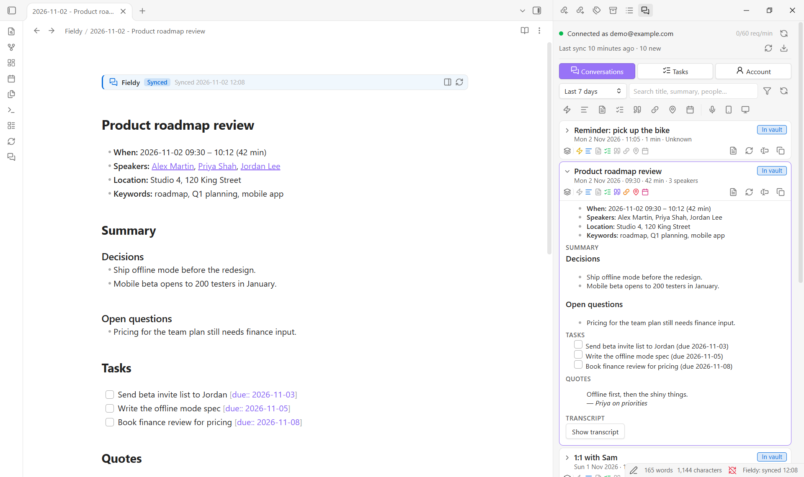

# Fieldy Sync

Import and synchronise your [Fieldy](https://fieldy.ai) conversations into clean, well-structured Markdown notes in Obsidian, without duplicates and without ever overwriting your own edits.

An Obsidian plugin by an independent developer, not affiliated with Fieldy. Its commands appear as `Fieldy Sync: …` in the command palette.

**New to Fieldy?** [Get Fieldy with $30 off](https://www.fieldy.ai/referral/157VTP5FKX?from=J%C3%89R%C3%94ME) (my referral link).



<sub>Screenshots use an invented demo account.</sub>

**Documentation:** this page covers installation and setup. The [user guide](https://github.com/jeromeauclair/fieldy-sync/blob/main/docs/guide.md) explains the panel, the note banners, dashboards, Dataview, edited notes, privacy filters, import and export. The [reference](https://github.com/jeromeauclair/fieldy-sync/blob/main/docs/reference.md) lists every setting and command and explains how sync works, with troubleshooting and an FAQ.

## Features

- **One note per conversation** with the title, date, duration, speakers, location and template; the summary and full memory content; tasks as checkboxes; quotes; and the transcript.
- **Safe, repeatable sync.** Notes are recognised by a stable `fieldy_id` property, so a sync never creates duplicates, even after you rename or move notes, and a sync with nothing new changes nothing on disk.
- **Your edits are protected.** Plugin content lives in a clearly marked section, shown as a banner with its state (*Synced*, *Edited* or *Paused*). Text outside it is never touched. If you edit inside it, sync leaves the note as you wrote it, and the original stays in Fieldy, one click away.
- **A side panel, no sync needed.** Browse conversations and tasks, see at a glance what each conversation contains, and insert or copy exactly the piece you need into any note. Mark tasks done, edit or cancel them in Fieldy.
- **Dashboards in any note.** A `fieldy` code block lists conversations, tasks or stats from your Fieldy notes, without any other plugin. Fieldy notes also work with [Dataview](https://github.com/blacksmithgu/obsidian-dataview), with ready-made queries one command away.
- **Import and export.** Bring in your entire history, or export it to Markdown, JSON, CSV or plain text.
- **Speakers linked to your people notes** (optional), so a person's note lists every conversation they were in.
- **Privacy filters.** Keep conversations out of your vault by keyword, speaker, place, Fieldy template or time (your lunch break, the weekend…); the panel shows them only as a brief "Private conversation" card. This is a filter, not security: anyone with your API key can still read everything in your Fieldy account.
- **Built for large accounts,** within Fieldy's rate limit, with manual, on-startup and periodic sync, optionally limited to the days and hours you choose.
- **Secure API key handling** with Obsidian's secret storage. The key is never written to the plugin's settings file, logs or notes.

## Requirements

- Obsidian **1.14.0** or newer. Tested on desktop (Windows, macOS, Linux). It also installs on phones and tablets, but mobile has not been tested yet: the plugin says so once on first start, and full mobile support is planned for 1.2.
- A Fieldy account and a Fieldy API key. No account yet? [Get Fieldy with $30 off](https://www.fieldy.ai/referral/157VTP5FKX?from=J%C3%89R%C3%94ME) (my referral link).

## Installation

### From Community plugins

1. Open **Settings → Community plugins** and turn off Restricted mode if needed.
2. Select **Browse**, search for **Fieldy Sync**, then **Install** and **Enable**.

Or open the [Fieldy Sync page](https://community.obsidian.md/plugins/fieldy-sync) in the plugin directory and select **Add to Obsidian**.

### Manual installation

1. Download `main.js`, `manifest.json` and `styles.css` from the [latest release](https://github.com/jeromeauclair/fieldy-sync/releases/latest).
2. Create the folder `<your vault>/.obsidian/plugins/fieldy-sync/` and copy the three files into it. (Your configuration folder may have a different name than `.obsidian` if you changed it.)
3. Restart Obsidian, open **Settings → Community plugins** and enable **Fieldy Sync**.

## Getting a Fieldy API key

API keys are created in the Fieldy mobile or desktop app under **Settings → Developer Settings**. The key is shown only once, so copy it before closing the dialog. See the official [Fieldy Public API documentation](https://fieldyai.github.io/docs/public-api.md) and the [API reference](https://api.fieldy.ai/docs).

## Setup

1. Open **Settings → Fieldy Sync → Connection**.
2. Under **API key**, choose an existing secret or create a new one and paste your Fieldy key into it. The key is stored in Obsidian's secret storage; the plugin only remembers the secret's name.
3. Select **Test connection**. On success you see the email address of your Fieldy account; nothing about the key is ever displayed.
4. Look through the other settings pages: **Sync** (sync window, sync times, automatic sync), **Folders and file names**, **Note content**, **Tasks**, **Transcript**, **People** and **Privacy**. Each setting explains itself, and previews show the result.
5. Run **Fieldy Sync: Sync now** or select the  ribbon icon. For older history, use **Fieldy Sync: Import conversations**.

Then open the panel with the  ribbon icon. The [user guide](https://github.com/jeromeauclair/fieldy-sync/blob/main/docs/guide.md) walks through it.

## At a glance

- **Notes.** Each conversation gets a note with a Fieldy section between two banners. Write your own notes below it. Ticking a task never counts as an edit. → [What a note looks like](https://github.com/jeromeauclair/fieldy-sync/blob/main/docs/reference.md#what-a-note-looks-like)
- **The panel.** The **Conversations** tab has search, icon filters, copy and insert of any piece, and create, refresh or restore of a note. The **Tasks** tab has open, done and dismissed tasks you can change in Fieldy, insertable as Obsidian Tasks items. The **Account** tab has connection, export, speaker profiles and memory templates. → [The Fieldy panel](https://github.com/jeromeauclair/fieldy-sync/blob/main/docs/guide.md#the-fieldy-panel)
- **Dashboards.** `show: conversations`, `tasks` or `stats` in a `fieldy` block, by period, speaker or kind, plus Dataview queries. → [Dashboards](https://github.com/jeromeauclair/fieldy-sync/blob/main/docs/guide.md#dashboards-fieldy-blocks)
- **Your edits.** Edit inside the section and the note is kept as you wrote it; restore the Fieldy version whenever you like, keeping your edits below it or not. → [Edited notes](https://github.com/jeromeauclair/fieldy-sync/blob/main/docs/guide.md#edited-notes)
- **Privacy.** Conversations matching your filters (keywords, speakers, places, templates, times) get no note, and the panel shows only that they exist. → [Privacy filters](https://github.com/jeromeauclair/fieldy-sync/blob/main/docs/guide.md#privacy-filters)
- **Changes in Fieldy.** The plugin only reads from Fieldy, except the task changes you click in the Tasks tab, the optional "Mark ticked tasks as completed in Fieldy", the share link switch on a card, and, if you turn it on, a share link for each new note (share links are public). → [What the plugin changes in Fieldy](https://github.com/jeromeauclair/fieldy-sync/blob/main/docs/reference.md#what-the-plugin-changes-in-fieldy)

## Privacy and security

- **Network:** the plugin communicates **only** with the official Fieldy API at `https://api.fieldy.ai`. There is no telemetry, analytics or other third-party service. Your API key never leaves your device except in the `Authorization` header of requests to Fieldy.
- **API key storage:** the key is kept in Obsidian's built-in secret storage (`app.secretStorage`) and selected with Obsidian's secret picker. The plugin's `data.json` stores only the *name* of the secret, never the key, so the key is not exposed if you sync, back up or share your plugin settings. How the secret store itself is protected on disk is determined by Obsidian. As with any Obsidian secret, other community plugins you install run with the same privileges, so only install plugins you trust.
- **No leaks:** the key is read from secret storage only at the moment of a request. It is never cached in settings or included in notes, notices, error messages, logs or diagnostics, and every message passes through secret redaction as a safeguard.
- **Untrusted content:** text from Fieldy is sanitised before it is written. HTML, Obsidian comments, wikilink and image embeds (which could pull in vault files or load remote images), `obsidian://` URIs and script links are neutralised, and file names can never point outside the vault.
- **Diagnostics** contain versions, settings (without the secret's name or your privacy filter entries), counts and error categories only, never error messages, note paths or conversation titles.
- **Vault-only:** all file access goes through Obsidian's Vault and FileManager APIs, inside your vault. `fieldy` blocks read your notes only.
- **Vault listing:** to find Fieldy notes wherever you moved or renamed them (by their `fieldy_id`), people notes for speaker links, and notes for `fieldy` blocks, the plugin goes through your vault's file list and the properties Obsidian already holds in memory. It doesn't open other notes' contents.
- **Clipboard:** written only when you click a copy button or command (a note piece, a share link, diagnostics without the API key). It is never read.
- **Privacy filters** are applied in Obsidian only: they are never sent anywhere, and transcript checks keep only whether a conversation matched, not its text. They are not a security feature: they only decide what gets a note and what some views show. Everything stays in your Fieldy account, and anyone with your API key can read all of it.
- **Share links** can be turned off completely (**Use Fieldy share links**): the plugin then never asks Fieldy about them, never creates one and shows none.
- **Links you open:** "Open in Google Maps" and "Open in OpenStreetMap" (on a conversation's location icon) and "Open the share link" open your browser at that address, only when you click them. The plugin itself sends nothing to those sites.

## Roadmap

Next: Fieldy tasks written in the [Tasks](https://publish.obsidian.md/tasks/) plugin format inside notes (the panel already inserts them that way) and your own Obsidian template for new notes (1.1), then mobile support (1.2). See [ROADMAP.md](https://github.com/jeromeauclair/fieldy-sync/blob/main/ROADMAP.md) and the [changelog](https://github.com/jeromeauclair/fieldy-sync/blob/main/CHANGELOG.md).

## Support

Questions and bug reports: [GitHub issues](https://github.com/jeromeauclair/fieldy-sync/issues). **Fieldy Sync: Copy diagnostics** copies a report without secrets to attach. To contribute, see [CONTRIBUTING.md](https://github.com/jeromeauclair/fieldy-sync/blob/main/CONTRIBUTING.md).

If this plugin saves you time, you can support its continued development:

[](https://buymeacoffee.com/jeromeauclair)

The donation link only appears in this README, the plugin listing and at the bottom of the plugin's settings. My Fieldy referral link ($30 off) appears in this README and, only while no API key is set, on the Connection settings page and in the panel. The plugin never shows pop-ups for either and never adds anything to your notes.

## Development

```bash
npm install
npm run dev          # watch build into main.js
npm run check        # typecheck, lint, unit tests and production build
npm test             # unit tests (never need an API key or network)
npm run test:live    # optional read-only checks against the real API
```

`test:live` reads `FIELDY_API_KEY` from the environment or from a git-ignored `.env.local` file (see `.env.example`) and performs GET requests only.

```
src/
  main.ts            plugin lifecycle, commands, scheduling
  api/               typed Fieldy client, transport, rate limiter, retry, validation
  sync/              sync engine, sync index, vault adapter, fingerprints
  privacy/           privacy filters and the transcript check cache
  markdown/          note and transcript rendering, managed section, sanitising, fieldy block queries
  export/            export formats (Markdown, JSON, CSV, text)
  settings/          settings model and settings pages
  ui/                note banners, fieldy blocks, import, export, edited and private notes dialogs, status bar
  ui/panel/          side panel: status, conversations, tasks, account
  utils/             errors, paths, dates, time rules, hashing, logging, redaction
tests/               Vitest unit tests (mocked network) and opt-in live tests
docs/guide.md        user guide
docs/reference.md    settings, commands, sync behaviour, troubleshooting
```

## License

Copyright 2026 Jérôme Auclair

Fieldy Sync is released under the [Functional Source License, Version 1.1, MIT Future License](LICENSE) (FSL-1.1-MIT). You may use, copy, change and share it for any purpose except a competing commercial product or service, that is, one that offers the same or similar functionality. Personal use, use at work, education and research are all allowed. Two years after each version is released, that version also becomes available under the MIT license.

The software is provided "as is", without warranty of any kind. See the [license](LICENSE) for the full terms.

The icons in the documentation are from [Lucide](https://lucide.dev), the icon set Obsidian uses, under the ISC License.

"Fieldy" is a trademark of its owner. This plugin is an independent integration and is not affiliated with or endorsed by Fieldy.
