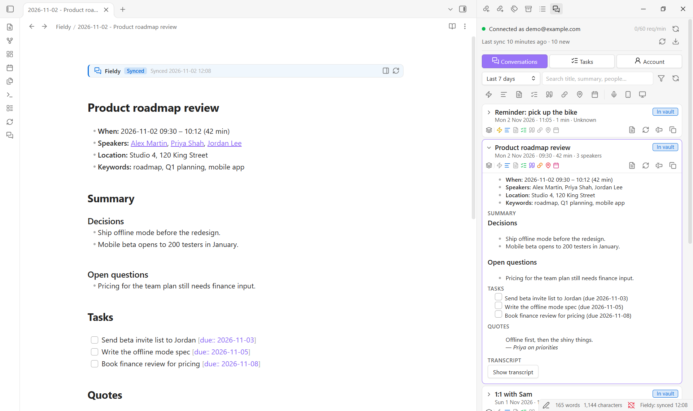
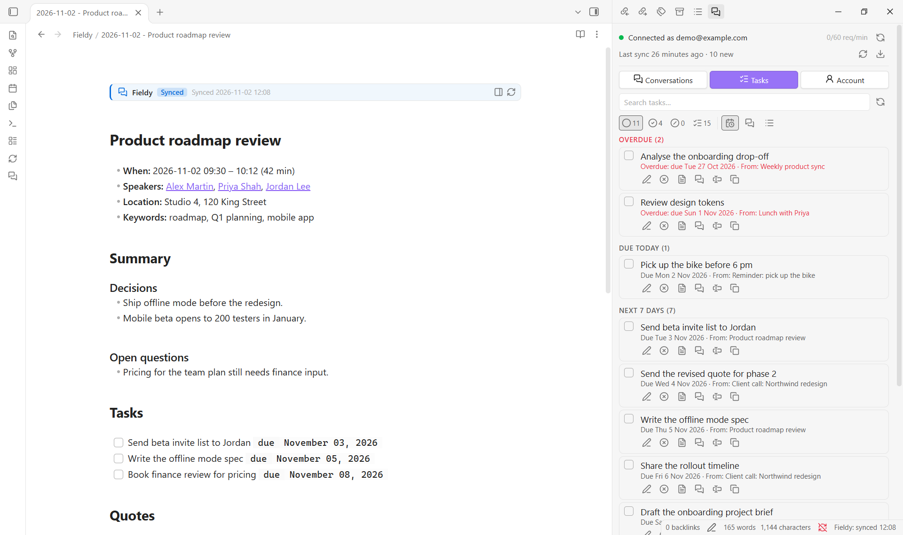
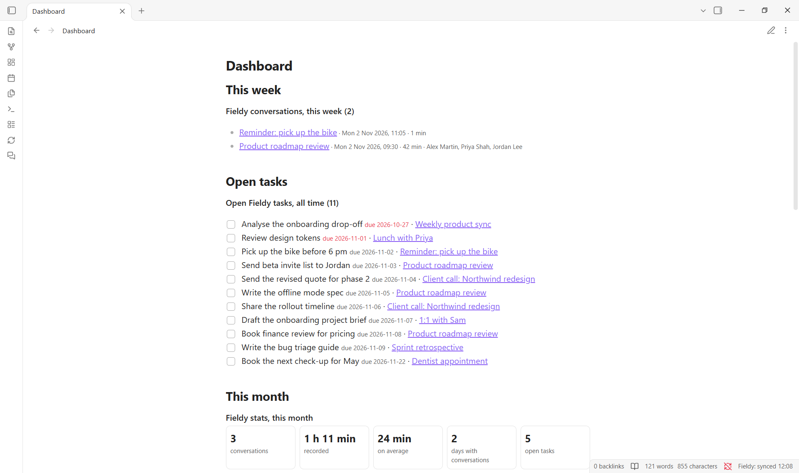
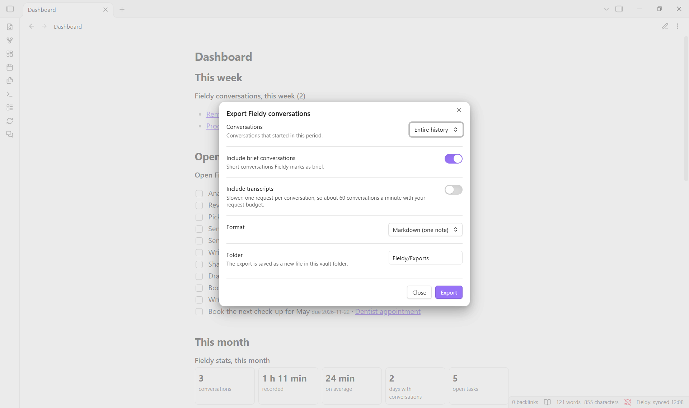

# Fieldy Sync user guide

How to use the side panel, the note banners, `fieldy` blocks, Dataview, edited notes, and import and export. For installation and setup, see the [README](../README.md). For every setting and the details of sync, see the [reference](reference.md).

- [The Fieldy panel](#the-fieldy-panel)
- [Note banners](#note-banners)
- [Tasks in notes](#tasks-in-notes)
- [Dashboards: fieldy blocks](#dashboards-fieldy-blocks)
- [Dataview](#dataview)
- [Edited notes](#edited-notes)
- [Import](#import)
- [Export](#export)

## The Fieldy panel

Open it with the speech-bubble ribbon icon or **Fieldy Sync: Open Fieldy panel**. It lives in the right sidebar and works independently of sync: you take exactly what you need, when you need it. Text you insert or copy from it is plain Markdown that belongs to you; it is never synced or updated afterwards.



### Status

At the top: a coloured dot with "Connected as you@example.com" (or what is wrong), the requests sent to Fieldy in the last minute against your request budget, and a button to check again. Below it: when the last sync ran and what it did, buttons to sync now or open the import dialog, and a pencil button listing your edited notes when there are any.

### Conversations

Pick a period (today; the last 3, 7, 14, 30 or 90 days; the last 12 months; or your entire history) and search the loaded conversations by title, summary, keyword or person. Older ones load page by page with **Load older conversations**; long lists are drawn 100 cards at a time as you scroll.

Each card shows the title, date, length and people, the note status, and a row of icons for what the conversation contains: coloured when present, grey when not (hover for details).

| Icon | Meaning |
| --- | --- |
| ⚡ | Brief: Fieldy's short format |
| ☰ | Summary |
| 📄 | Full memory content from your template |
| ☑ | Tasks (the tooltip gives the count) |
| ❝ | Quotes |
| 🔗 | An active Fieldy share link (checked in the background for the cards you see, faint until checked) |
| 📍 | Location |
| 📅 | Linked calendar event |

Before these, a grey icon shows where it was recorded: the Fieldy wearable 🎙, your phone 📱 or the desktop app 🖥. Fieldy does not include this in a conversation, so the panel looks it up in the background (one short listing per source for the loaded period). Click it to show only conversations recorded the same way.

**Card icons are buttons.** Click one to copy what it stands for: the summary, full memory content, tasks, quotes, share link, location or calendar event (⚡ copies the overview). Right-click it to insert it into the note you are editing instead, open the location in Google Maps or OpenStreetMap, or open the share link. While the [Tasks](https://publish.obsidian.md/tasks/) plugin is enabled, tasks and the calendar event are copied as Tasks items written with your Tasks settings (the event is scheduled ⏳ on its day); the right-click menu also offers this plugin's own format.

**Filters.** Under the search box, one button per icon filters the list: click once for "only with it", again for "only without it", a third time for "any". The recording sources follow (one at a time). The filter button next to the search box opens more filters: date, time of day, speaker, location and note status. Filters apply to the loaded conversations.

**Note status.** The label shows whether the conversation has a note (In vault, Not imported, Edited, Paused, Deleted from vault, Locked). It has a solid border when the last sync created the note and a dashed one when it updated it. Click it to open the note.

**Expand a card** to read its details, summary, tasks and quotes, and load its transcript on demand (and hide it again). For an edited note, it shows the Fieldy version next to yours. A card stays open while you search or filter, and after syncs.

The buttons on each card:

- **Open the note**, or **Create a note**: creates the same note a sync would, without running a sync.
- **Refresh** ⟳ the note from Fieldy, or, for a note you edited, **Restore** ↺ the Fieldy version (see [Edited notes](#edited-notes)).
- **Insert…** puts a piece at your cursor in the note you were last editing: the summary, tasks (also as Obsidian Tasks when that plugin is enabled), quotes, transcript, full memory content, title and details, the whole conversation, a link to its note, its share link or its ID. Pieces the conversation does not have are greyed out.
- **Copy…**: the same pieces, to the clipboard.

### Tasks

All your Fieldy tasks, searchable. The icons under the search box choose which tasks to show (open, completed, dismissed or all, each with its count) and how to group them (by due date: overdue, today, next 7 days, later, no date; by conversation; or not at all). Each task shows its due date and the conversation it came from.



- **Change them in Fieldy:** tick the checkbox to mark a task done, or untick it to reopen it. The buttons under each task reopen a dismissed task, edit its title and due date, cancel it (after confirmation), open its conversation's note, or show the conversation in the panel. Changes are sent to Fieldy only when you click, and the note shows them after the next sync.
- **Insert or copy** one task, or the whole list with **Insert all…** and **Copy all…**, as a Markdown checklist. When the Tasks plugin is enabled you can also insert them as Obsidian Tasks items, written with your Tasks settings, read each time: emoji or Dataview format, global filter, your symbols for done and cancelled, and whether to add created ➕, done ✅ and cancelled ❌ dates. Due dates use 📅, and each task links back to its note.

### Account

Connection details; sync status with the main actions (sync, import, edited notes, diagnostics); [Export conversations…](#export); your speaker profiles; and your memory templates with their instructions and when they last changed, ready to copy. Profiles and templates are read-only here (manage them in the Fieldy app) and are loaded once per panel; use **Reload profiles and templates** after changing them. Editing a template does not rewrite existing notes.

## Note banners

In Live Preview and reading view, the Fieldy section's markers are shown as two banners instead of `%% fieldy:begin %%` and `%% fieldy:end %%`:

- **The top banner** shows the section's state, when it was last synced, and buttons: show the conversation in the panel, **Refresh from Fieldy** ⟳ (synced notes) or **Restore the Fieldy version** ↺ (edited notes).
- **The end banner** marks where the section ends: your own notes go below it.

| State | Meaning |
| --- | --- |
| **Synced** (blue) | Kept up to date from Fieldy. |
| **Edited** (orange) | You changed the section, so sync leaves it as you wrote it. It changes the moment you type inside the section. |
| **Paused** (grey) | The note has `fieldy_sync: false`, so it is never updated. |

The banners are display only: the file still contains the plain markers, visible in source mode and in other apps. To edit a marker line, put the cursor on it with the keyboard or mouse and it shows as text. Turn banners off with **Section banner**, and pick your own colours for light and dark mode with **Banner colours** (both on the Note content settings page).

## Tasks in notes

Fieldy tasks linked to a conversation appear under **Tasks** in its note: open tasks as `- [ ]`, completed ones as `- [x]`, and optionally dismissed ones as `- [-]`, with their due date.

- **Ticking a box** is never treated as an edit, and your ticks are kept when the note updates.
- **Mark ticked tasks as completed in Fieldy** (off by default) sends a tick to Fieldy on the next sync.
- **Due dates as Dataview fields** (off by default) writes `[due:: 2026-11-05]` instead of `(due 2026-11-05)` for [Dataview](#dataview).

Writing tasks in the Tasks plugin's own format inside notes is planned for 1.1 (see the [roadmap](../ROADMAP.md)); the panel already inserts them that way.

## Dashboards: fieldy blocks

Put a `fieldy` code block in any note to list what your Fieldy notes contain. It reads your vault only (no requests to Fieldy), works without other plugins, and updates when your Fieldy notes change. **Fieldy Sync: Insert a Fieldy or Dataview query** inserts ready-made ones.

````markdown
```fieldy
show: tasks
tasks: open
```
````



| Option | Values | Default |
| --- | --- | --- |
| `show` | `conversations`, `tasks` or `stats` | `conversations` |
| `period` | `today`, `yesterday`, `this week`, `last week`, `this month`, `last month`, a number of days (`3 days`, `14 days`), `all`, a date (`2026-10-05`) or a range (`2026-10-01 to 2026-10-31`) | last 7 days (all time for tasks) |
| `speaker` | part of a speaker's name, such as `Marie` | anyone |
| `kind` | `all`, `full` or `brief` | `all` |
| `tasks` | `open`, `done` or `all` (for `show: tasks`) | `open` |
| `sort` | `newest`, `oldest` or `longest` (for conversations) | `newest` |
| `limit` | how many items to list | 50 |

- **conversations:** a list with date, length and people, each linking to its note.
- **tasks:** the tasks of the Fieldy sections, soonest due first (overdue in red), each linking to its line in the note. Tick them in the note or in the panel.
- **stats:** conversations, time recorded, average length, days with conversations, open and completed tasks, the longest conversation, the busiest days and the people you talk with most.

Weeks start on Monday. A mistake in a block shows a short message above the result instead of breaking the note. Lines starting with `#` are comments.

## Dataview

Fieldy notes carry their data as properties (`fieldy_id`, `fieldy_start`, `fieldy_end`, `fieldy_duration_minutes`, `fieldy_kind`, `fieldy_speakers`, `fieldy_keywords`, `fieldy_location`), and tasks inherit their note's properties, so [Dataview](https://github.com/blacksmithgu/obsidian-dataview) can query both. `WHERE fieldy_id` selects Fieldy notes. Turn on **Due dates as Dataview fields** (Tasks settings page) so Dataview can sort and filter tasks by due date.

Open Fieldy tasks, grouped by conversation:

````markdown
```dataview
TASK
WHERE fieldy_id AND !completed AND status = " "
SORT due ASC
GROUP BY file.link
```
````

Recent conversations:

````markdown
```dataview
TABLE WITHOUT ID file.link AS "Conversation", fieldy_start AS "Start", fieldy_duration_minutes AS "Minutes", fieldy_speakers AS "Speakers"
WHERE fieldy_id
SORT fieldy_start DESC
LIMIT 50
```
````

Minutes recorded per day over the last 30 days:

````markdown
```dataview
TABLE WITHOUT ID key AS "Day", length(rows) AS "Conversations", sum(rows.fieldy_duration_minutes) AS "Minutes"
WHERE fieldy_id AND date(fieldy_start) >= date(today) - dur(30 days)
GROUP BY dateformat(date(fieldy_start), "yyyy-MM-dd")
SORT key DESC
```
````

Conversations with someone, when speakers are linked to people notes (**Link speakers to people notes**):

````markdown
```dataview
TABLE WITHOUT ID file.link AS "Conversation", fieldy_start AS "Start"
WHERE fieldy_id AND contains(fieldy_speakers, [[Priya Shah]])
SORT fieldy_start DESC
```
````

## Edited notes

When you edit inside a note's Fieldy section, the note becomes your edited version: its banner turns to *Edited* and sync leaves it as you wrote it. Nothing is lost, because the original is still in Fieldy.

- **See the original:** the panel button on the banner, **Show Fieldy version of current note**, or the conversation's card in the panel.
- **Bring it back:** the ↺ button on the banner or the card, or **Review edited notes** (also for several notes at once).

| Choice | Result |
| --- | --- |
| **Restore Fieldy version, keep my edits below it** | The section gets the latest Fieldy content again, and your edited text is kept right below it under "Your edited version (kept …)". The note receives updates again. **Keep the transcript in your edited copy** decides whether that copy includes its transcript. |
| **Restore Fieldy version, discard my edits** | After confirmation, the section is replaced with the latest Fieldy content. Text outside it is kept. The note receives updates again. |

If you undo your edits yourself, the note goes back to receiving updates on its own. To freeze a note without editing it, set `fieldy_sync: false` in its properties.

## Import

**Fieldy Sync: Import conversations** (or the ⬇ button in the panel) brings in conversations outside the sync window: pick a period up to your entire history or a custom range, see each conversation's status (new, in vault, edited, paused, deleted, locked), filter by title, select, and choose the destination folder. The import runs in the background with progress in the status bar, and follows the same rules as sync: no duplicates, and edited notes are left alone.

## Export

**Export conversations…** (Account tab, or the command) saves conversations to one new file in your vault, `Fieldy/Exports` by default:



- **What:** the entire history, a preset period (3 days to 12 months) or a date range, with or without brief conversations.
- **Formats:** one Markdown note; JSON with all the data; CSV with one row per conversation, readable by any spreadsheet; or plain text.
- **Included:** each conversation's details, summary, full memory content, quotes and tasks; transcripts on request.
- **Time:** transcripts cost one request each, so the dialog shows the time left, and **Cancel export** stops without saving.
